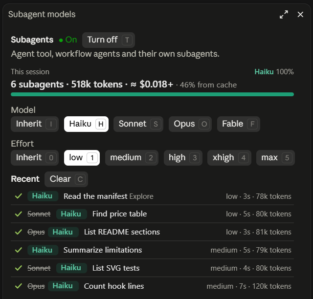

# ultracode-models

A Claude Code mod (terminal and Desktop) that sets **the model and effort of every subagent**:
- the ones the Agent tool launches;
- the ones `agent()` starts in an Ultracode workflow;
- the subagents those launch in turn.

Pick Haiku and **every** subagent runs on Haiku, whatever Claude or the workflow script asks for. The main conversation is never changed.



*The pane in Claude Desktop. Four of these subagents asked for Sonnet or Opus; all of them ran on Haiku, as the struck-through names show.*

## Install

In Claude Code started from a terminal (`claude`), type:

```
/plugin install ultracode-models --marketplace jBeyondstars/ultracode-models
```

Answer `y` to add the marketplace, then press Enter to install at user scope. The mod is active right away, and in every session started afterwards, including those of the Desktop app's Code tab (`/plugin` is not available there, hence the terminal).

To try a local copy without installing it: `claude --plugin-dir <folder>`, or add the folder to `CLAUDE_CODE_PLUGIN_DIRS` in the `env` block of `~/.claude/settings.json` (this also works for sessions the Desktop app starts).

## Usage

| Command | Effect |
| --- | --- |
| `/ultramodels` | opens or closes the settings pane |
| `/ultramodels haiku` | sets the model of every subagent |
| `/ultramodels sonnet medium` | sets the model and effort of every subagent |
| `/ultramodels effort low` | changes only the effort |
| `/ultramodels model <id> [effort]` | any model id (Bedrock ARN, gateway…) |
| `/ultramodels on`, `off`, `status`, `reset` | turns the mod on or off, shows the settings, resets everything to inherit |
| `/ultramodels log clear` | removes finished subagents from the pane's list |
| `/ultramodels help` | lists the commands |

Models accepted as is: `haiku`, `sonnet`, `opus`, `fable`, `inherit` (no change), or an id containing `claude-` (for example `claude-opus-4-8`). For any other id, use `model <id>`. Efforts: `low`, `medium`, `high`, `xhigh`, `max` or `inherit`.

### The pane

The pane (`/ultramodels`) reads from top to bottom:
- **the mod's state**, on or off, and a button to toggle it;
- **the session's counters**: how many subagents ran, the tokens they used, each model's share, an estimated price, and the share the prompt cache served. The token counts are exact: they are the API's own. Every request re-sends a subagent's whole context, so the total runs high, but most of it comes back from the cache, billed at a fraction of the input price. The price (`≈ $0.018`) is an estimate at the Claude API's list prices; a `+` after it means some tokens have no known price;
- **model** and **effort**: one row of buttons each, the active option highlighted, one click to change;
- **recent subagents**: the last 12. Each row shows a status mark (it spins while the agent works), the replaced model struck through when it is known for sure, the model that answered, the label, the effort, the duration and the tokens.

On Desktop, VS Code and mobile, the counters and the list are drawn as SVG and follow the light or dark theme. In the terminal they are plain text, and these keys work while the pane has focus:
- `h` `s` `o` `f` `i` for the model (Haiku, Sonnet, Opus, Fable, inherit);
- `0` to `5` for the effort;
- `t` to turn the mod on or off;
- `c` to clear the list.

The pane shows no "dollars saved", because they cannot be computed correctly:
- what the original model would have used is unknown (other answers, another tokenizer);
- the API does not say at which cache rate writes were billed.

### Asking Claude

You can also ask Claude to "put every subagent on Haiku". The mod gives it two tools:
- `status` shows the settings and the latest subagents;
- `configure` takes the command's arguments. It only works from the main conversation.

Whenever the settings change, and after a compaction, Claude gets a short note with the next prompt.

## How it works

The mod applies the same setting to every subagent, in whichever way the engine allows:
- **Ordinary subagent** (Agent tool, a subagent's own subagent): the model is set at launch (`agent.spawn` hook). Claude Code therefore knows it runs on Haiku, and the call's `model` parameter is replaced.
- **Workflow agent** (`agent()`) and **fork**: the engine does not allow changing them at launch, so the mod rewrites the model of **every request** before it is sent (`turn.step` hook).
- **Effort** is rewritten on every request, for all of them.

The setting is fixed when each subagent starts: changing it only affects subagents launched afterwards. Running subagents keep their setting even if the mod reloads.

If the engine itself switches a request to a fallback model (after a refusal, for example), the mod lets that choice through.

Settings persist across sessions, in the mod's storage.

## Known limitations

- An agent launched with `isolation: 'remote'` runs in the cloud and does not go through local hooks: it is not redirected.
- If the engine restarts a stuck workflow agent under a new id, that restart is not recognized.
- A redirected workflow agent or fork received a system prompt written for its original model: it may believe it is Opus while running on Haiku. The model shown after the arrow in the pane (and `answeredBy` in the `status` tool) is the one the API reports.
- The Workflow harness passes the user's original message to every agent. A small model like Haiku may take it as its own task when that message is itself an orchestration instruction ("launch 3 subagents…").
- Aliases (`sonnet`…) are turned into full ids (`claude-sonnet-5-5`), honoring `ANTHROPIC_DEFAULT_SONNET_MODEL`, `ANTHROPIC_DEFAULT_OPUS_MODEL` and `ANTHROPIC_DEFAULT_HAIKU_MODEL` when they are set. On Bedrock, Vertex or a gateway, set those variables or give a full id with `model <id>`.
- If the chosen model is not available to you, subagents fail and the mod shows a notification (one per workflow and model).
- The price is an estimate. It uses the Claude API's list prices, not Bedrock's, Vertex's, a gateway's or negotiated ones, and prices cache writes at the 5-minute rate Claude Code uses for subagents: the counts the mod receives don't say which cache duration was billed. Fast mode and other pricing options are left out, and on a Pro or Max subscription you don't pay per token at all.

## Development

```bash
claude plugin validate .
claude plugin test .
```

`tsc -p .` type-checks the mod once Claude Code has loaded it (with `--plugin-dir`, for example): Claude Code then writes its types to `.claude-plugin/types/`, a folder git ignores.

The tests cover:
- the pure logic, in `tests/logic.test.ts`;
- the SVG drawings, in `tests/svg.test.ts`;
- the whole mod, on an engine the test kit simulates, in `tests/mod.test.ts`.

On the mod side, they check in particular:
- every kind of subagent: Agent tool, workflow agent, fork, a subagent's own subagent;
- that the main conversation is left alone;
- reloads, waiting for a launch, the engine's fallback model;
- the note to the model, the tools, and the pane on terminal, desktop and mobile.
